# Old Town Walk

Walk or fly through 2 km by 2 km of Old Town Fort Collins, Colorado, in 3D. It is built only from open data (the
map, elevation, airborne lidar and roof colours sampled from aerial photographs) and rendered with
[Strata](https://github.com/Preponderous-Software/strata).

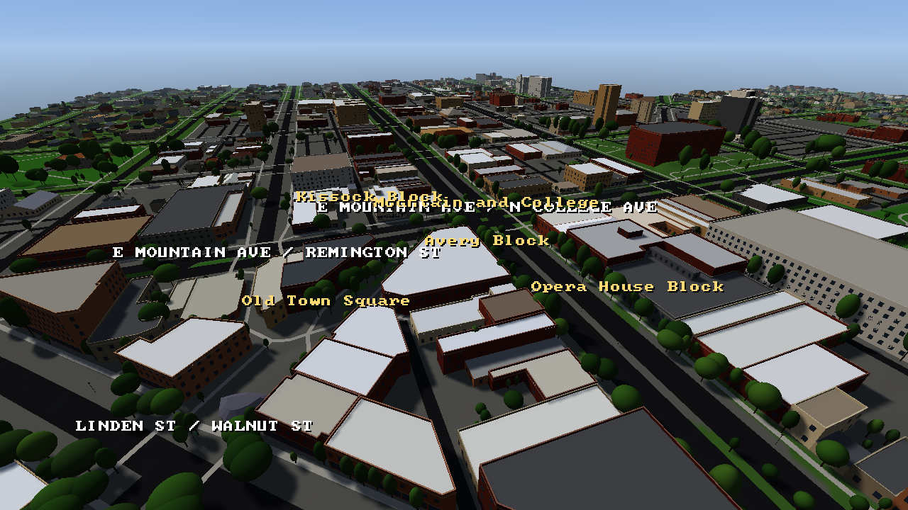

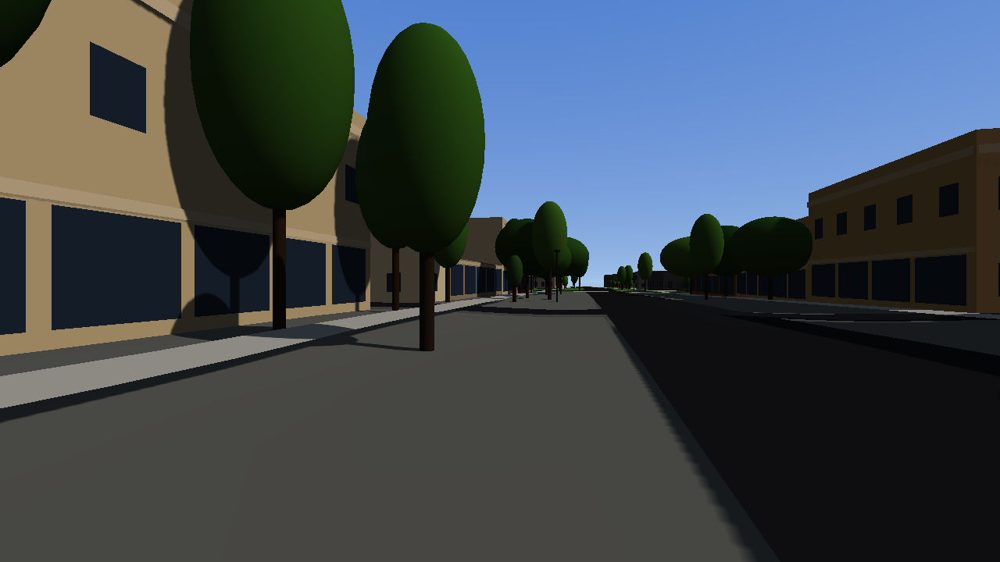

*Rendered by the real viewer. Map data © OpenStreetMap contributors (ODbL); elevation and lidar courtesy of the USGS;
roof colours sampled from USDA NAIP imagery.*

## Measured buildings

Every building's height and roof come from the USGS's airborne lidar survey of Fort Collins, and its roof colour from
aerial photographs. Before, all but 4% of buildings were one of two default boxes.

| Before | Now |
|---|---|
| 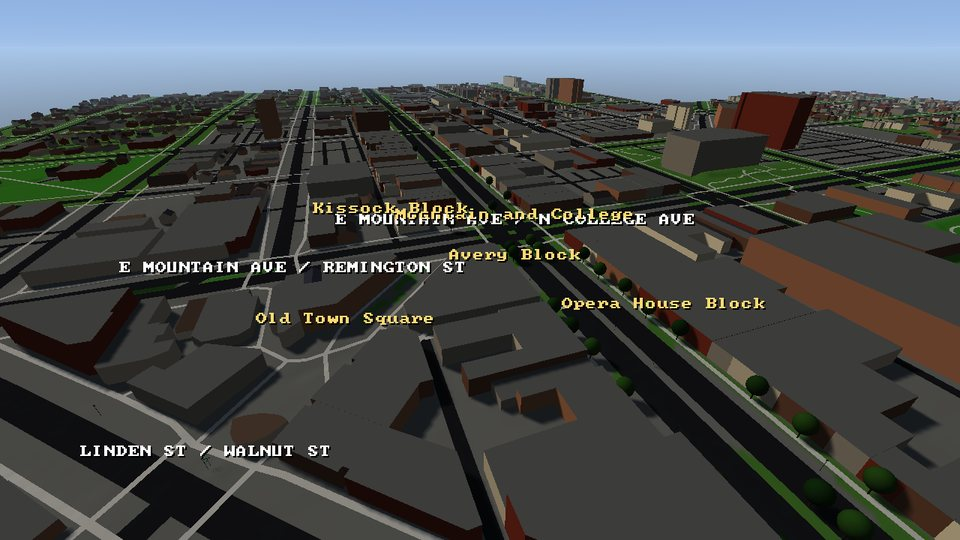 | 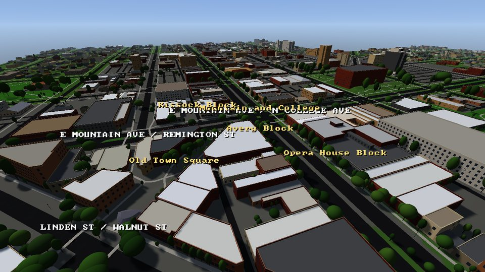 |
| 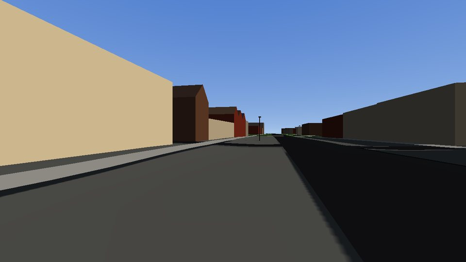 | 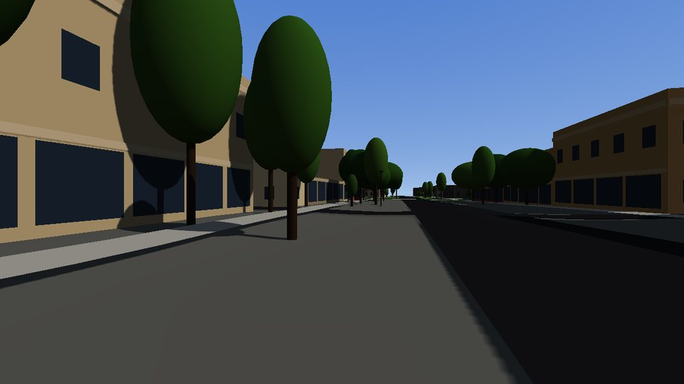 |
| 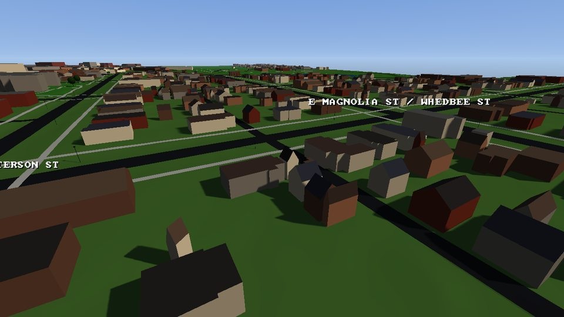 | 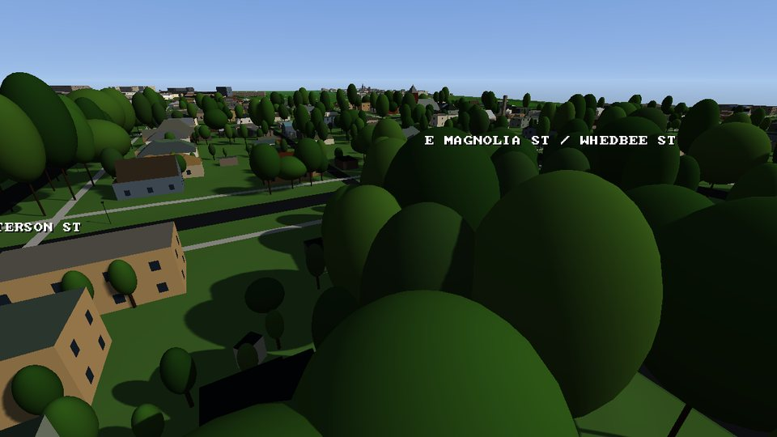 |

- **Heights.** The lidar is gridded to one metre (`data/raw/lidar-ndsm.tif`): the height of whatever stands above the
  ground in each cell. A footprint's cells give its eave and its roof. Cells under a tree's leaves are left out, since a
  pulse that splits on leaves gives itself away.
- **Roofs.** The footprint is turned square to its walls and covered with rectangles, which may overlap like the wings
  of a house. Flat, gabled and hipped roofs over those rectangles are each fitted to the lidar, with the pitch and eave
  free, and the one that fits clearly best is kept. A flat roof with a higher block on it gets that block, and a church
  gets its steeple. A building OSM splits into parts is drawn part by part.
- **Walls.** Rows of windows a storey apart, a glass front at street level on shops in the commercial district, a
  parapet and cornice on larger flat-roofed buildings, and no windows on a wall shared with the neighbour.
- **Colours.** Roof colours are sampled from aerial photographs (`data/raw/roof-colours.csv`, one colour a roof; the
  photographs themselves are not kept). Walls follow OSM's tags where mappers gave them, a few sourced facts in
  `data/building-overrides.csv`, and otherwise palettes by the kind of building.
- **Trees.** The survey also finds the trees: 23,000 of them, each at its measured height and crown width, where OSM
  maps about 900. Trees are drawn in full near you and thinned further out.

`uv run old-town-walk accuracy` compares every surveyed building as drawn with the lidar, cell by cell:

| | Median error | Within 1 m |
|---|---|---|
| Before: a default by kind | 1.98 m | 15% |
| Now: fitted to the lidar | 0.30 m | 98.7% |

The model is fitted to the same lidar it is measured against, so the second row says how well the shapes can follow
the survey, not how well they would predict a building it did not see. The survey dates from 2013: about 600 buildings
put up since then, or under trees it saw instead, fall back on their OSM tags and kind.

## Then and now

Old Town in old photographs, beside roughly the same view in the viewer today. The map shows the streets and buildings
of now, so the rail yards and streetcars are gone, and the views are matched by hand rather than exactly. The foothills
are missing because the map stops 2 km out.

| Then | Now |
|---|---|
| 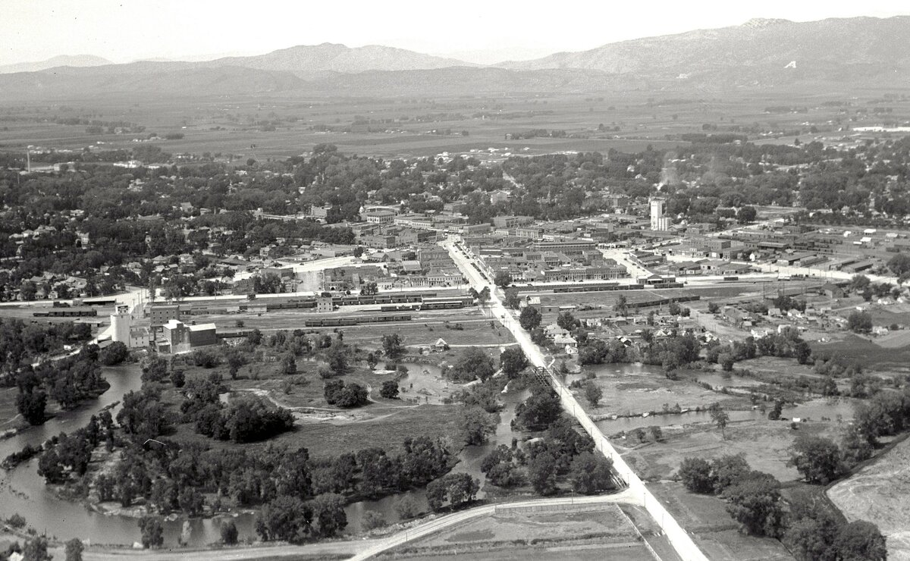 | 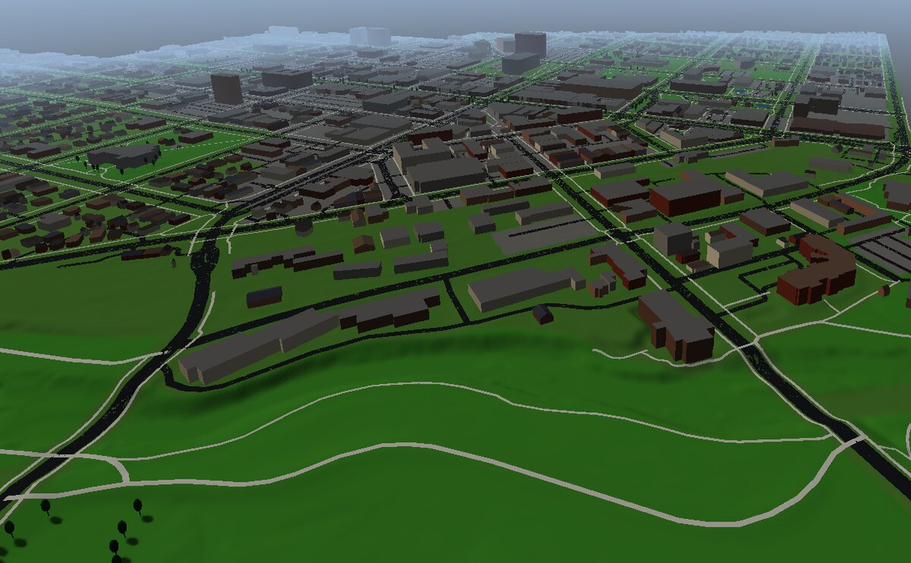 |
| **1929.** Looking west over the river, with Linden Street leading into town. | **Today, in the viewer.** |
| 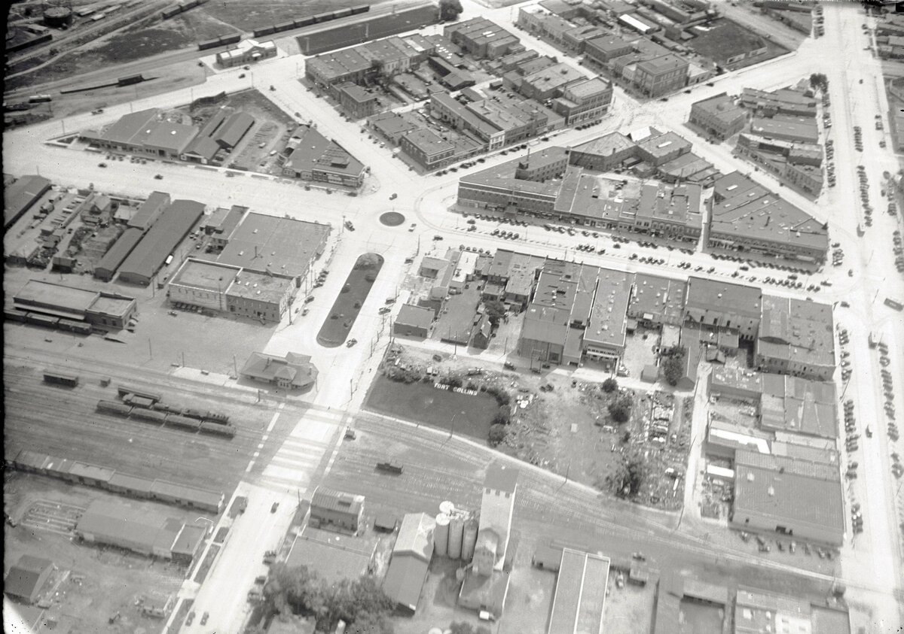 | 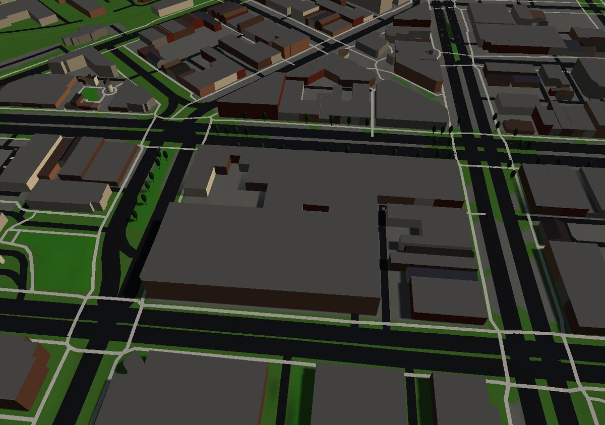 |
| **1929.** Looking east over downtown, with Mountain Avenue along the right. | **Today, in the viewer.** |
| 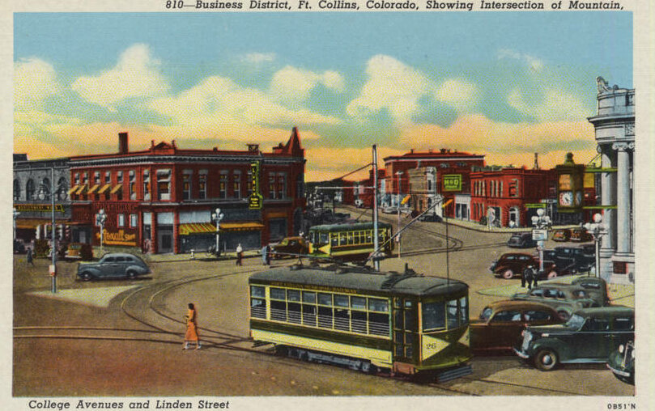 | 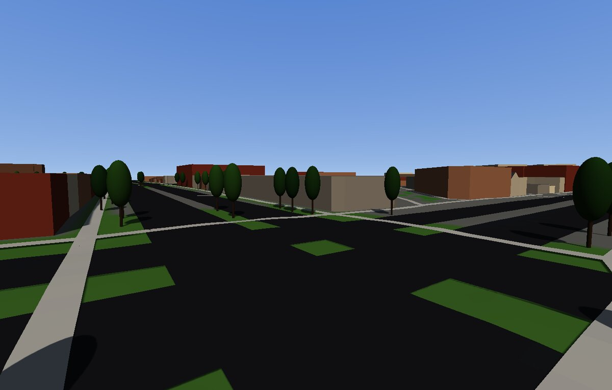 |
| **1940 postcard.** Mountain and College Avenues at Linden Street. | **Today, in the viewer.** Same intersection, camera angle approximate. |

*The 1929 photographs are from the Colorado State University archives and the postcard is from the Curt Teich collection at
the Newberry Library. All three are in the public domain in the United States; `NOTICE.md` has sources.*

## Download and run

On Windows, download `old-town-walk-windows.zip` from the releases page, unzip it, and double-click `old-town-walk.exe`.
There is nothing to install. It needs OpenGL 4.5, which most PCs from the last decade have.

The program is not code-signed, so Windows SmartScreen may warn about an unknown publisher. Choose **More info**, then
**Run anyway**.

Street signs stand at the crossings, and the status panel names the street you are on. A handful of public historic
places, listed with their sources in `data/landmarks.csv`, show their name as you come near and a sentence of history
when you reach them; in the browser, the Places list in the help panel takes you straight to one.

The bike rides like one: it builds up speed, coasts, turns in arcs, and cannot move sideways.

## Play in a browser

Play it now at **[old-town-walk.play.danielstephenson.dev](https://old-town-walk.play.danielstephenson.dev)**.

The page in `web/` runs the same tiles and walker on Strata's WebGL 2 backend and web kit. It needs WebGL 2 and works
with a keyboard and mouse or a touch screen: a stick to walk, drag to look, and buttons to fly, climb and descend.

```sh
source /path/to/emsdk/emsdk_env.sh     # emsdk 6.0.11, Strata's pin
uv run old-town-walk build
emcmake cmake -S . -B build-web -DCMAKE_BUILD_TYPE=Release
cmake --build build-web -j8
uv run python tools/build_site.py build-web build/tiles web-site
python3 -m http.server 8000 --directory web-site
```

Tiles are downloaded as they are needed, gzipped, and the page unpacks them, so the map costs about 4 MB to start and
13 MB if you walk all of it. Your settings, and a note that you have seen the controls, are kept in that browser only,
and nothing is reported. A link to a spot is made only when you ask for one, and nothing about it is stored or reported.
`web/smoke/smoke.cjs` plays it in headless Chromium, on a desktop and a phone profile, with real input.

## Controls

Press **H** to see these at any time. They work in the desktop viewer and in a browser with a keyboard.

On a touch screen, use the on-screen stick and buttons, plus the Settings section of the controls panel, which the **?**
button opens. Zoom, field of view and screenshots need a keyboard.

| Key | What it does |
|---|---|
| WASD | Move. On foot you stop at walls; in the air you follow your view. |
| Mouse or arrow keys | Look |
| Shift | Go faster: run, fly four times as fast, or sprint on the bike. The panel shows the speed you are going. |
| Space | Jump. In the air, Space climbs. |
| F | Fly, or land on the ground outside any building. On the bike, either F or R gets you off. |
| E or Space, Q | Climb and descend while flying. Ctrl descends too, on the desktop. |
| Mouse wheel, or Page Up and Page Down | Set your speed: 5 to 800 m/s flying, 3 to 40 m/s on the bike, 0.7 to 14 m/s on foot |
| `-` and `=` | Shorten or lengthen the view, 200 to 1,500 m |
| `,` and `.` | Mouse sensitivity |
| 9 and 0 | Field of view, 40 to 110 degrees |
| I | Invert the mouse's up and down |
| Z | Hold to zoom in on something far away |
| B | Get on or off the bike: W pedals, S brakes and backs up, A and D steer, Shift goes faster |
| M | Browser only: show or hide the map, also with the Map button. Shift+M or a click on the map opens it large, where a click on a spot takes you there. |
| R | Back to where you started |
| `[` and `]` | Time of day. Street lamps and lit windows come on as the sun goes down, and the posts stand all day. |
| P | Save a screenshot, as a download in a browser |
| L | Browser only: share a link to where you are, with your view, mode and the time of day. The controls panel has a button for it. |
| Tab | Hide the status panel |
| Backspace | Put every setting back to its default. Press it again straight away to undo. |
| Esc | Free the mouse. A click takes it back. On the desktop, Esc again quits. |

The desktop viewer remembers your settings between runs, in `old-town-walk/settings.txt` under your user configuration
folder. To keep the view level on the bike, add a line `reduce_motion 1` there while the game is closed. The browser
follows your system's reduced-motion setting instead.
`old-town-walk --help` lists the command-line options.

## Building it

Needs Python 3.12 via [uv](https://docs.astral.sh/uv/), CMake ≥ 3.24, a C++17 compiler and OpenGL 4.5. The build is
offline apart from fetching Strata.

```sh
uv run old-town-walk verify     # the data matches data/raw/SOURCES.json
uv run old-town-walk build      # -> build/tiles/
cmake -S . -B build/app && cmake --build build/app -j4
./build/app/old-town-walk       # finds build/tiles by itself; --tiles DIR picks another folder
```

To refresh the data, `uv run old-town-walk fetch` downloads it into `build/fetched`, which is never committed, because a
full OpenStreetMap download carries contributor names and business contact details. `uv run old-town-walk sanitize` then
reduces it to the geometry and the few tags the build reads. `uv run --group lidar old-town-walk lidar` downloads the
survey's point tiles (about 260 MB, into `build/fetched/lidar`) and grids them, and `uv run old-town-walk roofs`
samples the roof colours from aerial photographs it downloads into `build/fetched`.

Headless, with `LIBGL_ALWAYS_SOFTWARE=1 GALLIUM_DRIVER=llvmpipe` where there is no GPU:

```sh
./build/app/old-town-walk --headless --yaw 90 --walk-ahead 30 --screenshot out.png
./build/app/old-town-walk --headless --radius 300 --pass-east -900 --bench 20
```

## How the tiles work

- **The grid is global.** A tile is a 500 m square of UTM zone 13N, named by `floor(east / 500)` and
  `floor(north / 500)`. Its name never depends on which area was built, so areas can grow without renaming.
- **Tiles are self-contained.** Positions are relative to the tile's north-west corner, and the viewer adds the offset
  on load. Precision stays the same wherever the tile is, which suits 32-bit floats.
- **No seams.** Neighbours share their edge samples, and each height grid has one extra row all round so normals match
  across the edge. A feature belongs to the tile holding its centre, and may overhang into the next tile.
- **Streaming is a pure function.** `app/streaming.h` takes the position and what is loaded, and returns what to load
  and unload. A tile loads within the load radius, stays until 200 m beyond it, and the budget keeps Strata under its
  limit of 256 meshes at four meshes a tile.
- **Terrain is a static mesh per tile**, not `strata_set_terrain`, because Strata holds one terrain tile at a time.

The layout is documented at the top of `old_town_walk/tiles.py`. `manifest.txt` lists every tile with its size and hash.

## Limits

- Tiles load on the main thread, one a frame, and there is no level of detail.
- The lidar is from 2013. Buildings put up since then get their height from OSM tags or a default by kind.
- Roofs are flat, gabled or hipped over rectangles; mansards, domes and curved roofs are not modelled, and footprints
  that are not square to their walls get a simple hip.
- Wall colours are mostly palettes by kind of building: neither the map nor the survey can see a wall.
- Water is only a colour, you can walk on it, and bridges are not modelled.

## License

The code is MIT (see `LICENSE`). The data is not: see `NOTICE.md`. Map data © OpenStreetMap contributors, under the
Open Database License. Elevation and lidar courtesy of the U.S. Geological Survey; roof colours sampled from USDA NAIP
imagery.
